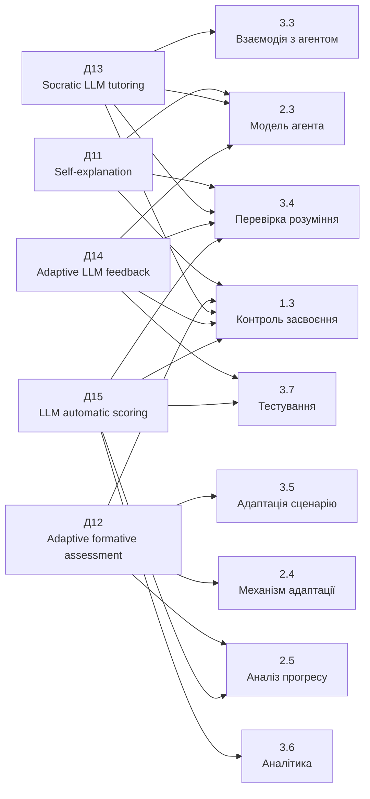

# Наукові джерела про перевірку розуміння та діалогове навчання для адаптивного ШІ-агента

## Виконавче резюме

За результатами цільового пошуку відібрано **рівно 5 нових джерел [Д11]–[Д15]**. Вони доповнюють уже зібрані [Д1]–[Д10] не загальними твердженнями про користь ШІ, а саме науковою опорою для найбільш слабко покритих механізмів твоєї моделі: **self-explanation, формувального адаптивного оцінювання, сократівського діалогу, персоналізованого LLM-feedback та автоматизованого аналізу відкритих відповідей**. Нумерацію підрозділів використовую відповідно до твого робочого шаблону. fileciteturn0file0

Найважливіший результат пошуку: частину того, що в шаблоні зараз позначено як **«проєктний висновок»**, уже можна підкріпити прямими емпіричними даними. Зокрема, сфокусовані запити на самопояснення можуть покращувати опрацювання матеріалу **під час підтримуваного навчання**, хоча цей ефект не обов'язково переноситься на незалежне післятестове завдання; адаптивний LLM-feedback може покращувати **якість обґрунтування**, але не обов'язково правильність рішення; а LLM можуть оцінювати відкриті відповіді, причому результат суттєво залежить від рубрики, контексту й способу prompting. citeturn20view2turn17search0turn28search1

Для твоєї концепції це дає сильніший доказовий ланцюжок:

**відповідь студента → вимога пояснення/обґрунтування → аналіз відкритої відповіді → персоналізований feedback → повторне формувальне оцінювання → вибір наступної навчальної дії.**

Однак знайдені результати **не доводять**, що конкретно твоя комбінація «правильна відповідь → поясни власними словами → відповідай на уточнювальне питання → застосуй у новій ситуації» гарантовано визначає реальне розуміння. Її коректно подавати як **авторський механізм, окремі складові якого спираються на емпіричні дослідження**. Так само автоматичну оцінку LLM не варто використовувати як безумовне остаточне педагогічне рішення: дослідження показують відмінності між якістю аргументації та правильністю рішення, а точність автоматичного scoring істотно залежить від конфігурації системи. citeturn17search0turn28search1

## Методика пошуку та відбору

Пошук проводився як **цільовий структурований пошук**, а не як повний систематичний огляд. Перевірялися роботи 2020–2026 років за комбінаціями англомовних і україномовних запитів навколо `self-explanation prompts`, `formative assessment`, `adaptive formative assessment`, `Socratic tutoring`, `dialogic tutoring`, `LLM tutor`, `open-ended response assessment`, `automatic scoring`, `LLM-generated feedback`, `student understanding`, а також «формувальне оцінювання», «самопояснення», «діалогове навчання», «оцінювання відкритих відповідей» і «ШІ в освіті».

Пошук охоплював офіційні сторінки Springer Nature, Elsevier/ScienceDirect, ACL Anthology та матеріали Educational Data Mining, а також українські академічні журнали й репозитарії. Для фінальної п'ятірки пріоритет було віддано не географічному різноманіттю, а **прямій відповідності конкретним механізмам прототипу та силі доказів**. У результаті українські кандидати не витіснили сильніші емпіричні роботи з self-explanation, адаптивного feedback, Socratic LLM tutoring та автоматичного scoring; український контекст уже представлений у попередньому наборі [Д6]–[Д10].

Усі п'ять відібраних робіт датовані **2022–2025 роками**. Дві безпосередньо працюють із вищою/педагогічною освітою, одна — з університетським курсом програмування, одна — з автоматизацією Socratic tutoring, а одна — з автоматичним оцінюванням письмових відповідей. Для статей Elsevier статус peer review додатково підтверджується політикою видавця: статті в його open-access journals проходять повне експертне рецензування. citeturn16search0 Для EMNLP 2025 офіційно застосовувався double-blind review через ACL Rolling Review. citeturn22search1turn22search3

## П’ять відібраних публікацій

**[Д11] Monika Martin, Meg Farrell, Tina Seidel, Werner Rieß, Karen D. Könings, Jeroen J. G. van Merriënboer, Alexander Renkl. (2022). *Focused self-explanation prompts and segmenting foster pre-service teachers’ professional vision - but only during training!***

**Бібліографія:** Martin, M., Farrell, M., Seidel, T., Rieß, W., Könings, K. D., van Merriënboer, J. J. G., & Renkl, A. (2022). *Focused self-explanation prompts and segmenting foster pre-service teachers’ professional vision - but only during training!*. **International Journal of Educational Technology in Higher Education, 19**, Article 34. Офіційна сторінка Springer підтверджує всіх авторів, рік, том і номер статті. citeturn20view2

**DOI:** `10.1186/s41239-022-00331-z`  
**Оригінал:** https://link.springer.com/article/10.1186/s41239-022-00331-z

**Тип і peer review.** Експериментальна research article. На офіційній сторінці зазначені дати received/accepted, а в acknowledgements автори прямо дякують двом анонімним рецензентам, що підтверджує зовнішнє рецензування роботи. citeturn18search0

**Проблема і методи.** Автори перевіряли, чи покращують сегментація навчального відео та **focused self-explanation prompts** здатність майбутніх учителів помічати й інтерпретувати педагогічно важливі події. В експерименті взяли участь **89 майбутніх учителів біології**; у 60-хвилинному тренінгу вони були розподілені між вісьмома умовами, утвореними комбінацією сегментованого/несегментованого відео, відкритих/сфокусованих self-explanation prompts та двох типів вступного теоретичного матеріалу. Результати оцінювали за письмовими аналізами відео до і після тренінгу. citeturn18search0turn20view2

**Основні результати.** Загалом після тренінгу учасники краще помічали релевантні педагогічні події та більше спиралися на теоретичне знання під час їх інтерпретації. Під час самого тренінгу **сфокусовані self-explanation prompts** приводили до кращого помічання релевантних стратегій, ніж менш структурована підтримка. Проте ця перевага **не дала вищого приросту на незалежному posttest**, коли додаткова підтримка вже була відсутня. Автори тому прямо застерігають від висновку, що більша продуктивність із підказками автоматично означає стійкіше навчання, і пропонують досліджувати поступове зменшення підтримки. citeturn20view2

**Корисність для курсової: 1.3, 2.3, 3.3, 3.4.**

Тези для шаблону:

- Сфокусовані запити на самопояснення можуть спрямовувати увагу здобувача на релевантні аспекти матеріалу та стимулювати зв'язування конкретного випадку з теоретичними знаннями. citeturn20view2
- Структурований self-explanation може підвищувати якість роботи **під час підтримуваного навчального етапу**, однак цей ефект не слід автоматично прирівнювати до стійкого засвоєння. citeturn20view2
- Відсутність переваги на незалежному posttest означає, що механізм перевірки розуміння повинен містити завдання без тієї самої підтримки, яка використовувалася під час навчання. Це обережний проєктний висновок із результатів дослідження. citeturn20view2

**Обмеження.** Дослідження стосується professional vision майбутніх учителів і роботи з відео, а не LLM-агента. Воно також показало перевагу prompts під час тренінгу, але **не підтвердило їхнього додаткового ефекту на posttest**, що дуже важливо не приховувати в курсовій. citeturn20view2

**[Д12] Albert C. M. Yang, Brendan Flanagan, Hiroaki Ogata. (2022). *Adaptive formative assessment system based on computerized adaptive testing and the learning memory cycle for personalized learning***

**Бібліографія:** Yang, A. C. M., Flanagan, B., & Ogata, H. (2022). *Adaptive formative assessment system based on computerized adaptive testing and the learning memory cycle for personalized learning*. **Computers and Education: Artificial Intelligence, 3**, Article 100104. Бібліографічні дані підтверджуються ScienceDirect та DOAJ. citeturn19search0turn19search3

**DOI:** `10.1016/j.caeai.2022.100104`  
**Оригінал:** https://www.sciencedirect.com/science/article/pii/S2666920X22000595

**Тип і peer review.** Емпірична research article про розроблення та експериментальну перевірку адаптивної формувальної системи. Журнал *Computers and Education: Artificial Intelligence* є open-access журналом Elsevier; Elsevier підтверджує, що статті його open-access journals проходять повне peer review. citeturn19search0turn16search0

**Проблема і методи.** Автори виходили з того, що традиційне Computerized Adaptive Testing зазвичай оптимізоване для **одноразового вимірювання**, тоді як формувальне оцінювання має допомагати студентові повторно визначати стан знань і слабкі місця. Запропонована система поєднує CAT, що враховує знання студента та складність завдання, з **learning memory cycle**, який моделює утримання вивченого матеріалу. Систему протягом **семи тижнів** порівнювали в університетському курсі програмування з CAT-only системою та традиційним неадаптивним оцінюванням. citeturn19search0

**Основні результати.** Студенти, які використовували запропоноване адаптивне формувальне оцінювання, перевершили дві групи порівняння за **learning performance**. Вони також демонстрували вищу залученість у practice tests і роботу з навчальними матеріалами. Таким чином, дослідження підтримує підхід, за якого оцінювання не є одноразовою фінальною операцією, а повторюється й використовується для формування наступної навчальної активності. Водночас у відкритій офіційній HTML-анотації, яку вдалося перевірити, не наведено розмір вибірки та конкретні effect sizes, тому я їх не домислюю. citeturn19search0turn19search1

**Корисність для курсової: 1.3, 2.4, 2.5, 3.5, 3.7.**

Тези для шаблону:

- Формувальне оцінювання в адаптивній системі доцільно розглядати як **повторюваний процес визначення стану знань**, а не як одноразову перевірку. citeturn19search0
- Вибір наступних завдань може враховувати поточний рівень знань здобувача та складність навчального завдання. citeturn19search0
- Модель адаптації може враховувати не лише факт попередньої правильної відповіді, а й зміну знань із часом та необхідність повторної перевірки засвоєння. citeturn19search0
- Емпіричне порівняння в університетському курсі програмування показало перевагу циклічного адаптивного formative assessment над CAT-only і традиційним неадаптивним оцінюванням за результатами навчання та engagement. citeturn19search0

**Обмеження.** Стаття працює переважно з adaptive testing, а не з діалоговим аналізом відкритих пояснень. Тому вона добре обґрунтовує **цикл повторного оцінювання й адаптації**, але не метод LLM-оцінювання самопояснення. citeturn19search0

**[Д13] Xian Peng, Pan Yuan, Dong Li, Junlong Cheng, Qin Fang, Zhi Liu. (2025). *KELE: A Multi-Agent Framework for Structured Socratic Teaching with Large Language Models***

**Бібліографія:** Peng, X., Yuan, P., Li, D., Cheng, J., Fang, Q., & Liu, Z. (2025). *KELE: A Multi-Agent Framework for Structured Socratic Teaching with Large Language Models*. In **Findings of the Association for Computational Linguistics: EMNLP 2025**, pp. 16342–16362. Association for Computational Linguistics, Suzhou, China. citeturn20view1

**DOI:** `10.18653/v1/2025.findings-emnlp.888`  
**Оригінал:** https://aclanthology.org/2025.findings-emnlp.888/

**Тип і peer review.** Рецензована конференційна публікація у *Findings of ACL: EMNLP 2025*. EMNLP 2025 використовував ACL Rolling Review, author response/meta-review та **double-blind reviewing**; офіційна сторінка конференції прямо описує цей процес. citeturn22search0turn22search1turn22search3

**Проблема і методи.** Автори досліджують, як перенести **Socratic teaching** у LLM-середовище так, щоб діалог був не випадковою послідовністю питань, а структурованим педагогічним процесом. KELE використовує систему правил SocRule та multi-agent схему **«consultant–teacher»**, де один LLM відповідає за планування, а інший — за виконання навчального діалогу. Автори також створили SocratDataset із **34 педагогічними стратегіями та понад 42 000 діалогових ходів** і систему оцінювання якості сократівського навчання за **9 вимірами**, від окремої репліки до багатокрокового діалогу. citeturn20view1

**Основні результати.** Спеціалізована модель SocratTeachLLM у проведених авторами експериментах **статистично значуще перевершила GPT-4o за всіма досліджуваними Socratic teaching capabilities**. Робота демонструє, що сократівську поведінку агента можна формалізувати через окремі педагогічні стратегії, план навчальної взаємодії та багатовимірну оцінку якості діалогу. Важливо, однак, що основним об'єктом оцінювання була **якість поведінки моделей**, а не довготривалі навчальні результати реальних студентів. Тому робота підтверджує технічну можливість структурованого Socratic tutoring, але не доводить, що KELE підвищує академічну успішність студентів. citeturn17search3turn20view1

**Корисність для курсової: 1.2, 1.3, 2.3, 3.3, 3.4.**

Тези для шаблону:

- Діалоговий навчальний агент можна проєктувати як систему **педагогічних діалогових стратегій**, а не як універсальний чат, що просто генерує чергову відповідь. citeturn20view1
- У LLM-based Socratic tutoring доцільно відокремлювати планування навчального діалогу від безпосередньої генерації наступної репліки; саме такий поділ реалізовано в consultant–teacher architecture KELE. citeturn20view1
- Якість навчального діалогу є багатовимірною характеристикою і може оцінюватися не лише за окремою відповіддю, а й за логікою багатокрокової взаємодії. citeturn20view1
- Сократівську взаємодію можна формалізувати у вигляді набору педагогічних правил і стратегій, що особливо релевантно для проєктування логіки інтелектуального агента. citeturn20view1

**Обмеження.** Це передусім NLP/LLM-дослідження. Воно не є педагогічним RCT зі студентами, тому фразу «Socratic LLM-agent покращує засвоєння студентів» на його основі писати не можна. Коректніше: **структурований сократівський діалог може бути програмно реалізований і формально оцінений**. citeturn20view1

**[Д14] Annette Kinder, Fiona J. Briese, Marius Jacobs, Niclas Dern, Niels Glodny, Simon Jacobs, Samuel Leßmann. (2025). *Effects of adaptive feedback generated by a large language model: A case study in teacher education***

**Бібліографія:** Kinder, A., Briese, F. J., Jacobs, M., Dern, N., Glodny, N., Jacobs, S., & Leßmann, S. (2025). *Effects of adaptive feedback generated by a large language model: A case study in teacher education*. **Computers and Education: Artificial Intelligence, 8**, Article 100349. citeturn17search0

**DOI:** `10.1016/j.caeai.2024.100349`  
**Оригінал:** https://www.sciencedirect.com/science/article/pii/S2666920X24001528

**Тип і peer review.** Research article; **randomized controlled trial**. Стаття опублікована в open-access журналі Elsevier, для якого видавець підтверджує повне peer review. citeturn17search0turn16search0

**Проблема і методи.** Автори перевіряли, чи може response-contingent feedback, згенерований general-purpose LLM, покращити наступне виконання складного письмового завдання. **269 майбутніх учителів у Німеччині** випадково розподілили між adaptive feedback, створеним GPT-4-1106-preview на основі конкретної відповіді студента, та однаковим для всіх static feedback, підготовленим експертом. Після feedback учасники виконували друге diagnostic-reasoning task; окремо оцінювали accuracy рішення, якість обґрунтування, довжину тексту, сприйняття feedback і час його опрацювання. citeturn17search0

**Основні результати.** Adaptive LLM-feedback **статистично значуще покращив якість обґрунтування**, але між групами не було значущої різниці в **decision accuracy**. Студенти після adaptive feedback писали довші тексти; для цього ефекту `f² = 0.170`, `p < .001`, тобто ефект був помітно більшим, ніж більшість інших зафіксованих ефектів. Adaptive feedback також оцінювали як корисніший (`p = .023`, `r = .138`) та цікавіший (`p = .003`, `r = .184`), а його читання було повільнішим на слово (`p = .002`, `r = .192`), що автори інтерпретують як глибше опрацювання feedback. citeturn17search0

**Корисність для курсової: 1.3, 2.3, 3.3, 3.4, 3.7.**

Тези для шаблону:

- Персоналізований feedback, сформований LLM відповідно до конкретної відповіді здобувача, може покращувати **якість подальшого обґрунтування** порівняно зі статичним feedback. citeturn17search0
- Якість пояснення та правильність рішення є різними характеристиками: покращення аргументації після adaptive feedback у цьому дослідженні **не супроводжувалося статистично значущим покращенням decision accuracy**. citeturn17search0
- Тому модель прогресу доцільно не зводити до одного показника правильності відповіді; обґрунтування рішення може розглядатися як окрема характеристика навчальної діяльності. Це проєктний висновок, безпосередньо мотивований розділенням outcome variables у дослідженні. citeturn17search0
- Response-contingent LLM-feedback є технічно реалістичним способом персоналізації feedback у великому навчальному середовищі, де індивідуальний feedback викладача складно масштабувати. citeturn17search0

**Обмеження.** Adaptive condition відрізнявся від control не тільки адаптивністю, а й **джерелом feedback**: LLM проти людини. Автори прямо зазначають, що ефект тому неможливо приписати лише adaptiveness. Дослідження містило лише один основний feedback cycle, більшість ефектів були малими, а стійкість покращення в часі не перевірялася. citeturn17search0

**[Д15] Gyeong-Geon Lee, Ehsan Latif, Xuansheng Wu, Ninghao Liu, Xiaoming Zhai. (2024). *Applying large language models and chain-of-thought for automatic scoring***

**Бібліографія:** Lee, G.-G., Latif, E., Wu, X., Liu, N., & Zhai, X. (2024). *Applying large language models and chain-of-thought for automatic scoring*. **Computers and Education: Artificial Intelligence, 6**, Article 100213. Дані про назву, авторів, DOI й номер статті підтверджуються ScienceDirect. citeturn28search1turn28search5

**DOI:** `10.1016/j.caeai.2024.100213`  
**Оригінал:** https://www.sciencedirect.com/science/article/pii/S2666920X24000146

**Тип і peer review.** Емпірична research article з експериментальним порівнянням LLM-підходів до automatic scoring. *Computers and Education: Artificial Intelligence* є open-access журналом Elsevier; повне peer review таких статей підтверджене політикою видавця. citeturn28search1turn16search0

**Проблема і методи.** Автори досліджували, наскільки GPT-3.5 та GPT-4 можуть автоматично оцінювати **письмові відповіді студентів/учнів на природничо-наукові завдання**, і чи покращує результат Chain-of-Thought prompting. Тестовий набір містив **1650 відповідей на шість assessment tasks**, а експеримент порівнював шість prompting strategies, що комбінували zero-shot/few-shot learning, CoT, умову завдання й scoring rubric. citeturn28search1turn28academia25

**Основні результати.** Few-shot prompting досяг точності **0.67 проти 0.60** для zero-shot, що автори характеризують як покращення на 12,6%. Сам CoT без контексту завдання та рубрики не дав значущого приросту (`accuracy = 0.60`). Натомість CoT у поєднанні з **item stem та scoring rubric** збільшував accuracy на 13,44% у zero-shot та на 3,7% у few-shot configuration; GPT-4 також перевершував GPT-3.5 у низці конфігурацій, із зафіксованою різницею до 8,64%. Це показує, що якість автоматичного оцінювання залежить не просто від вибору «сильнішої LLM», а від того, наскільки явно системі передано критерії, контекст завдання та спосіб reasoning. citeturn28academia25turn28search1

**Корисність для курсової: 1.3, 2.3, 2.5, 3.4, 3.6, 3.7.**

Тези для шаблону:

- Відкриті текстові відповіді можуть бути об'єктом автоматизованого LLM-based scoring, однак його якість суттєво залежить від структури prompting та критеріїв оцінювання. citeturn28search1turn28academia25
- Надання LLM **scoring rubric та контексту конкретного завдання** може суттєво підвищувати якість автоматичного оцінювання порівняно з менш контекстною конфігурацією. citeturn28academia25
- Chain-of-Thought сам по собі не гарантує покращення scoring: у дослідженні користь з'являлася тоді, коли CoT поєднувався з предметним контекстом і рубрикою. citeturn28academia25
- Для програмного прототипу доцільніше передавати агенту чіткі критерії очікуваного розуміння конкретного поняття, ніж просити LLM абстрактно визначити, «чи студент зрозумів тему». Це проєктний висновок, прямо мотивований експериментальними відмінностями між prompting conditions. citeturn28academia25
- Оскільки навіть найкраща перевірена конфігурація не досягала абсолютної точності, автоматичний результат слід трактувати як оцінку системи, а не безпомилковий ground truth. citeturn28academia25

**Обмеження.** Робота перевіряє automatic scoring конкретного набору science responses, а не повноцінного адаптивного агента. Вона також не доводить, що автоматична оцінка сама по собі покращує навчання — досліджується передусім **якість scoring**. citeturn28search1

## Порівняльна таблиця та карта покриття

| Код | Автори, рік | Основний фокус | Тип / емпірична база | DOI | Найсильніші підрозділи |
|---|---|---|---|---|---|
| **Д11** | Martin et al., 2022 | Self-explanation prompts | Експеримент, `N=89` майбутніх учителів | `10.1186/s41239-022-00331-z` | **1.3, 3.4**, 2.3, 3.3 |
| **Д12** | Yang, Flanagan, Ogata, 2022 | Adaptive formative assessment | 7-тижневий експеримент, університетський programming course | `10.1016/j.caeai.2022.100104` | **2.4, 3.5**, 1.3, 2.5 |
| **Д13** | Peng et al., 2025 | Structured Socratic LLM tutoring | Multi-agent framework; 34 strategies, >42k dialogue turns | `10.18653/v1/2025.findings-emnlp.888` | **2.3, 3.3**, 1.3, 3.4 |
| **Д14** | Kinder et al., 2025 | Adaptive LLM feedback | RCT, `N=269` майбутніх учителів | `10.1016/j.caeai.2024.100349` | **1.3, 3.4**, 2.3, 3.7 |
| **Д15** | Lee et al., 2024 | LLM scoring відкритих відповідей | 1 650 responses, 6 prompting strategies | `10.1016/j.caeai.2024.100213` | **3.4, 3.7**, 1.3, 2.5, 3.6 |

Бібліографічні та методологічні характеристики в таблиці взяті з офіційних сторінок публікацій і видавців. citeturn20view2turn19search0turn20view1turn17search0turn28search1

Карта нижче показує не класифікацію авторів, а **моє зіставлення результатів публікацій із твоїм планом** на основі описаних методів і висновків. citeturn20view2turn19search0turn20view1turn17search0turn28search1

У сукупності ці роботи закривають різні ланки одного процесу. **Д11** дає педагогічну основу для вимоги пояснення, але одночасно показує необхідність незалежної перевірки після scaffolded interaction. **Д12** переводить оцінювання в циклічний adaptive formative process. **Д13** дає програмну модель структурованого сократівського діалогу. **Д14** показує, що LLM-feedback може покращити обґрунтування, але не обов'язково правильність рішення. **Д15** показує, як відкриту відповідь можна формалізовано оцінювати LLM і чому агенту потрібна явна rubric/context, а не довільне «оціни розуміння». citeturn20view2turn19search0turn20view1turn17search0turn28academia25

## Тези для безпосереднього внесення до шаблону

Нижче формулювання навмисно наближені до стилю твого консолідованого шаблону, щоб їх можна було додати як **[Д11]–[Д15]** без написання повного теоретичного тексту.

**До 1.3 «Проблема контролю фактичного засвоєння навчального матеріалу»:**

> - Самопояснення є способом активізації опрацювання матеріалу: сфокусовані self-explanation prompts можуть спрямовувати здобувача на зв'язування конкретної інформації з релевантними теоретичними поняттями. Водночас перевага такої підтримки під час навчання не обов'язково переноситься на незалежне виконання наступного завдання. [Д11] citeturn20view2

> - Якість обґрунтування та правильність рішення слід розглядати як різні характеристики навчальної відповіді: у рандомізованому дослідженні adaptive LLM-feedback покращив якість аргументації, але не забезпечив статистично значущого покращення decision accuracy. [Д14] citeturn17search0

> - Автоматичне оцінювання відкритих відповідей за допомогою LLM є можливим, однак його точність залежить від наявності контексту завдання, scoring rubric та способу prompting; використання LLM без достатнього предметного й критеріального контексту знижує надійність оцінювання. [Д15] citeturn28academia25turn28search1

Ці три тези суттєво посилюють 1.3 порівняно з поточним станом: тепер є наукова опора не лише для твердження «кінцева відповідь недостатня», яке дав Д9, а й для аналізу **пояснення, аргументації та відкритої відповіді** як додаткових інформаційних сигналів.

**До 2.3 «Модель роботи інтелектуального навчального агента»:**

> - Діалогову поведінку навчального агента можна структурувати як набір педагогічних стратегій і правил, що визначають логіку послідовності уточнювальних питань, а не як необмежену генерацію реплік. У KELE такий підхід реалізовано через структуровані Socratic teaching rules та розподіл функцій планування й виконання діалогу між агентами. [Д13] citeturn20view1

> - Якість роботи діалогового агента доцільно оцінювати не тільки на рівні окремої відповіді, а й на рівні послідовності багатокрокового навчального діалогу. [Д13] citeturn20view1

> - Adaptive feedback може формуватися на основі конкретної відповіді студента та містити персоналізовані рекомендації щодо покращення подальшого виконання завдання. [Д14] citeturn17search0

Це дозволяє зробити твій цикл **«відповідь → аналіз → наступна дія»** значно конкретнішим: між аналізом і наступною дією з'являється **pedagogical dialogue policy**.

**До 2.4 «Механізм адаптації навчального процесу»:**

> - Формувальне оцінювання може бути організоване як повторюваний адаптивний цикл, у якому поточний стан знань використовується для вибору наступних завдань і подальшої перевірки слабких місць. [Д12] citeturn19search0

> - Під час адаптації доцільно враховувати не лише результат останньої відповіді, а й необхідність повторного оцінювання раніше засвоєного матеріалу з урахуванням зміни стану знань із часом. [Д12] citeturn19search0

Тут Д12 добре доповнює твої Д1–Д3: адаптація вже виглядає не лише як **branching після помилки**, а як повторюваний assessment loop.

**До 2.5 «Модель аналізу навчального прогресу»:**

> - Показники правильності відповіді та якості її обґрунтування не є взаємозамінними й можуть відображати різні аспекти навчальної діяльності. [Д14] citeturn17search0

> - Рівень знань доцільно оцінювати динамічно через повторні формувальні перевірки, оскільки адаптивне оцінювання може враховувати не тільки складність завдання та поточний стан знань, а й утримання раніше опрацьованого матеріалу. [Д12] citeturn19search0

> - Для автоматичного аналізу відкритих відповідей необхідно визначати предметні критерії оцінювання; експериментальні результати LLM-based scoring показують, що явні rubrics та task context підвищують точність оцінки. [Д15] citeturn28academia25

Це дає основу для розділення майбутнього learner state щонайменше на **correctness**, **reasoning/justification quality** і **динаміку повторних перевірок**, не стверджуючи, що конкретна формула вже валідована.

**До 3.3 «Реалізація взаємодії студента з інтелектуальним навчальним агентом»:**

> - Проєктування діалогової взаємодії з LLM-агентом може спиратися на структурований сократівський підхід, у якому агент використовує визначені педагогічні стратегії та послідовність уточнювальних питань для підтримання процесу міркування. [Д13] citeturn20view1

> - Агент може формувати feedback, адаптований до конкретної відповіді студента, замість видачі однакового заздалегідь підготовленого повідомлення для всіх здобувачів. [Д14] citeturn17search0

**До 3.4 «Реалізація механізму перевірки фактичного розуміння матеріалу»:**

> - Сфокусовані запити на самопояснення можуть використовуватись як один із способів спонукання студента пов'язати конкретну відповідь із релевантними поняттями та аргументувати її, однак результат такої підтримки слід додатково перевіряти в завданні без ідентичних підказок. [Д11] citeturn20view2

> - Перевірку відповіді доцільно розділяти щонайменше на оцінювання правильності результату та якості його обґрунтування, оскільки покращення одного показника не гарантує покращення іншого. [Д14] citeturn17search0

> - Для автоматизованого аналізу відкритого пояснення доцільно передавати LLM не лише текст відповіді, а й умову завдання та чітку rubric із критеріями рівнів розуміння; такі компоненти експериментально покращували automatic scoring. [Д15] citeturn28academia25

> - **Проєктний висновок:** правильна відповідь може запускати додатковий етап перевірки, у якому агент просить обґрунтувати рішення, а результат цього обґрунтування оцінюється окремо. Ефективність саме такого повного алгоритму не перевірялася жодним із відібраних досліджень, хоча окремі його складові мають емпіричну підтримку. [Д11, Д14, Д15] citeturn20view2turn17search0turn28search1

Останнє формулювання, на мою думку, дуже важливе: після цього пошуку твій механізм уже не виглядає як довільна ідея, але й не видається за експериментально доведену технологію.

**До 3.5 «Реалізація адаптації навчального сценарію»:**

> - Результати поточного оцінювання можуть використовуватися для автоматичного визначення наступного навчального завдання, а повторне оцінювання дозволяє виявляти актуальний стан знань і слабкі місця студента. [Д12] citeturn19search0

> - **Проєктний висновок:** результат аналізу відкритого пояснення може бути одним із вхідних параметрів вибору наступної навчальної дії поряд із правильністю основної відповіді. [Д14, Д15] citeturn17search0turn28search1

**До 3.7 «Тестування прототипу та аналіз результатів»:**

> - Тестування механізму перевірки розуміння доцільно проводити окремо для правильності рішення та якості обґрунтування, оскільки ці показники можуть змінюватися незалежно один від одного. [Д14] citeturn17search0

> - При тестуванні автоматичного оцінювання відкритих відповідей необхідно порівнювати результати агента з еталонними оцінками за визначеною rubric, а не обмежуватися перевіркою того, чи система технічно повертає певний score. [Д15] citeturn28search1turn28academia25

## Пріоритет оновлення шаблону

**Першим я б оновив 1.3 і 3.4.** Саме тут нова п'ятірка найбільше змінює якість доказової бази. До цього Д9 переважно доводив **необхідність** не довіряти одному кінцевому результату. Тепер Д11 додає self-explanation, Д14 — окреме вимірювання якості обґрунтування, а Д15 — методологію LLM-based analysis відкритої відповіді. citeturn20view2turn17search0turn28search1

**Другим — 2.3 і 3.3.** Д13 дозволяє перейти від нечіткого поняття «ШІ-агент ставить уточнювальні питання» до значно сильнішого положення: діалог агента може мати **структуровану pedagogical policy**, набір Socratic strategies та окремий етап планування наступного педагогічного ходу. citeturn20view1

**Третім — 2.4 і 3.5.** Д12 дає хорошу емпіричну опору для циклу **assessment → learner state → next task → reassessment**, тобто саме для механізму адаптивного переходу між навчальними станами. citeturn19search0

Після інтеграції [Д11]–[Д15] центральну логіку майбутнього прототипу вже можна науково мотивувати приблизно так:

> **Навчальний агент не повинен визначати рівень засвоєння лише за фактом правильної відповіді. Додаткову інформацію про розуміння може давати здатність здобувача обґрунтувати відповідь у відкритій формі; self-explanation prompts можуть спрямовувати таку активність, а LLM може використовувати предметно визначену rubric для структурованого аналізу відповіді. Результат оцінювання доцільно використовувати у повторюваному формувальному циклі для визначення наступної навчальної дії, водночас автоматичну оцінку не слід трактувати як безпомилкове остаточне педагогічне рішення.** [Д11–Д15] citeturn20view2turn19search0turn20view1turn17search0turn28academia25

Це, на мою оцінку, найважливіший результат цього етапу пошуку: він перетворює одну з центральних ідей курсової — **«не просто перевіряти відповідь, а перевіряти розуміння»** — із загальної концепції на послідовність окремих механізмів, для яких уже існує сучасна емпірична або технічна наукова база, водночас залишаючи чесно позначеною межу між результатами літератури та твоїм власним алгоритмом. citeturn20view2turn17search0turn19search0turn20view1turn28search1
